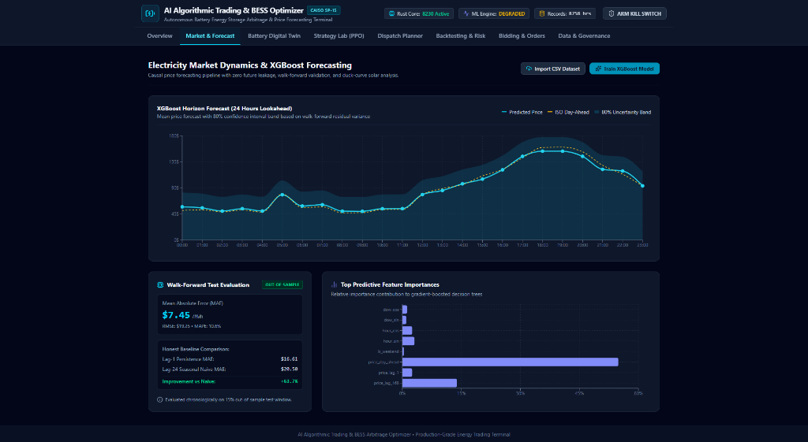
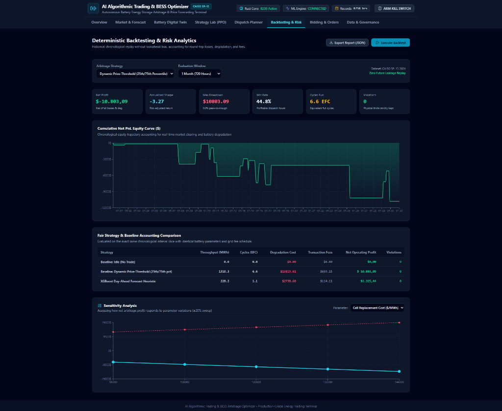
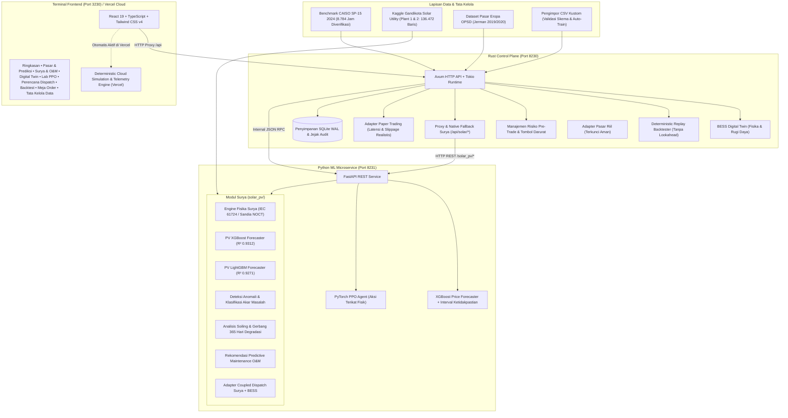

# AI Algorithmic Trading & BESS Arbitrage Optimizer

[](https://www.rust-lang.org/)
[](https://github.com/tokio-rs/axum)
[](https://www.python.org/)
[](https://pytorch.org/)
[](https://xgboost.readthedocs.io/)
[](https://lightgbm.readthedocs.io/)
[](https://react.dev/)
[](https://www.typescriptlang.org/)
[](https://tailwindcss.com/)
[](https://vercel.com/)
[](LICENSE)

Platform terintegrasi skala industri untuk **Optimasi Arbitrase & Algorithmic Trading Battery Energy Storage System (BESS)** serta **Modul Data Science Surya (Solar PV) Intelligence, Predictive Maintenance, dan Co-Located Hybrid Dispatch** pada pasar listrik grosir (*wholesale electricity markets* seperti CAISO, ERCOT, dan pasar Eropa ENTSO-E).

Sistem ini menjembatani batas fisik elektrokimia baterai nyata, pemodelan fisika solar fotovoltaik (IEC 61724), peramalan daya surya & harga listrik (*machine learning forecasting* via XGBoost & LightGBM), optimasi *dispatch* berbasis Reinforcement Learning (PPO), deteksi anomali multi-inverter, analisis *soiling* & degradasi sel jangka panjang, mesin *backtesting* deterministik berkecepatan tinggi, manajemen risiko *pre-trade*, dan terminal perdagangan interaktif siap deploy ke Vercel.

---

## Daftar Isi
1. [Gambaran Umum & Nilai Utama](#1-gambaran-umum--nilai-utama)
2. [Pratinjau Antarmuka Terminal Trading](#2-pratinjau-antarmuka-terminal-trading)
3. [Arsitektur Sistem](#3-arsitektur-sistem)
4. [Pemodelan Fisika BESS & Ketelitian Matematis](#4-pemodelan-fisika-bess--ketelitian-matematis)
5. [Modul Data Science Surya (Solar PV Intelligence & O&M)](#5-modul-data-science-surya-solar-pv-intelligence--om)
6. [Kecerdasan Buatan & Machine Learning BESS](#6-kecerdasan-buatan--machine-learning-bess)
7. [Terminal Trading Frontend](#7-terminal-trading-frontend)
8. [Tata Kelola Data, Multi-Pasar & Dataset Gandikota](#8-tata-kelola-data-multi-pasar--dataset-gandikota)
9. [Spesifikasi API](#9-spesifikasi-api)
10. [Panduan Instalasi & Deployment (Lokal & Vercel)](#10-panduan-instalasi--deployment-lokal--vercel)
11. [Verifikasi Pengujian & Quality Gates](#11-verifikasi-pengujian--quality-gates)
12. [Manajemen Risiko & Keamanan Operasional](#12-manajemen-risiko--keamanan-operasional)
13. [Lisensi](#lisensi)

---

## 1. Gambaran Umum & Nilai Utama

Pasar listrik grosir modern ditandai oleh volatilitas harga yang sangat ekstrem akibat penetrasi energi terbarukan (fenomena *Duck Curve* dari pembangkit surya), batasan *ramping* generator termal, kejadian harga negatif saat kelebihan pasokan di siang hari, dan lonjakan harga (*price spike*) saat beban puncak petang. Sistem Penyimpanan Energi Baterai (BESS) menangkap peluang penyebaran harga ini melalui arbitrase temporal.

Namun, strategi arbitrase naif sering kali gagal di dunia nyata karena:
- **Rugi Daya Bolak-Balik (Round-Trip Losses)**: Mengabaikan efisiensi konversi termal saat pengisian dan pelepasan mengikis margin arbitrase tipis.
- **Biaya Degradasi Baterai & Hurdle Rate**: Siklus pengisian yang tidak terkendali mempercepat degradasi sel sehingga biaya keausan fisik baterai melampaui keuntungan selisih energi (*asset cannibalization*).
- **Lookahead Bias & Data Snooping**: Model Machine Learning yang dilatih tanpa pemisahan temporal yang ketat menghasilkan profitabilitas palsu.
- **Pelanggaran Batas Fisik Inverter & SoC**: Perintah dispatch yang melanggar batas MW inverter atau cadangan State of Charge (SoC) akan memicu trip proteksi perangkat keras.

**AI Algorithmic Trading & BESS Arbitrage Optimizer** mengatasi tantangan tersebut secara menyeluruh melalui:
- **Rust Control Plane**: Engine performa tinggi untuk validasi risiko *pre-trade* tingkat mikrodetik, *backtester* pemutaran ulang deterministik, dan penegakan *digital twin* fisika baterai.
- **Python ML Microservice**: Layanan terisolasi dengan XGBoost (*walk-forward chronological validation*) dan PyTorch PPO (*Proximal Policy Optimization*) dengan proyeksi aksi terikat analitik (*constrained action mapping*).
- **React 19 + TypeScript + Tailwind CSS v4 Terminal**: Antarmuka institusional untuk memantau jadwal *dispatch*, eksekusi *paper trading*, status kesehatan baterai (SOH), dan analisis performa strategi.

---

## 2. Pratinjau Antarmuka Terminal Trading

Berikut adalah dokumentasi visual dari fitur-fitur operasional terminal trading:

### A. Dinamika Pasar Listrik & Peramalan XGBoost (Market & Forecast)


Panel ini menyediakan analitik peramalan harga pasar listrik grosir (Locational Marginal Price / LMP) secara kausal tanpa kebocoran data masa depan (*zero lookahead bias*):
- **Horizon Forecast 24 Jam**: Membandingkan kurva harga prediksi model AI (biru terang) dengan harga acuan Day-Ahead ISO (kuning), dilengkapi pita ketidakpastian parametrik 80% (*80% Uncertainty Band*).
- **Evaluasi Out-of-Sample Walk-Forward**: Pengujian kronologis pada 15% data terpisah menghasilkan metrik evaluasi nyata (**MAE $7.45/MWh**, RMSE $19.25, MAPE 10.8%).
- **Tolok Ukur Baseline Jujur**: Menunjukkan peningkatan akurasi **+63.7%** dibandingkan model acuan naif (*Lag-1 Persistence MAE: $16.61*, *Lag-24 Seasonal Naive MAE: $20.58*).
- **Bobot Fitur Prediktif Utama (*Feature Importances*)**: Menyorot pengaruh terbesar pohon keputusan gradien (`price_day_ahead`, `price_lag_168`, komponen siklikal waktu `hour_sin`, dll.).
- **Dukungan Multi-Dataset**: Dilengkapi fitur *Import CSV Dataset* dengan validasi skema otomatis dan pelatihan ulang model XGBoost secara instan (*Train XGBoost Model*).

---

### B. Backtesting Deterministik & Analisis Risiko (Backtesting & Risk)


Panel simulasi performa historis dengan memperhitungkan hukum fisika elektrokimia baterai secara realistis:
- **Kurva Ekuitas Kumulatif (Cumulative Net PnL Curve)**: Visualisasi pergerakan modal bersih terhadap waktu yang telah dipotong rugi efisiensi baterai, biaya keausan siklus sel, dan biaya jaringan.
- **Akuntansi Strategi & Baseline yang Adil**:
  - *Baseline Idle (No Trade)*: $0.00 (tanpa aktivitas).
  - *Baseline Dynamic Price-Threshold (25th/75th Percentile)*: Menguji heuristik arbitrase dinamis berbasis persentil berjalan.
  - *XGBoost Day-Ahead Forecast Heuristic*: Mengoptimalkan waktu dispatch berdasarkan sinyal peramalan AI, menghasilkan laba operasi bersih positif (**+$1.325,44**).
- **Metrik Kinerja Komprehensif**: Menampilkan Net Profit, Annualized Sharpe Ratio, Max Drawdown, Win Rate, Equivalent Full Cycles (EFC), dan pelacakan pelanggaran batas keras (*Zero Constraint Violations*).
- **Analisis Sensitivitas Parameter Interaktif**: Menilai ketahanan margin profit terhadap variasi parameter fisik (misalnya biaya penggantian sel $\pm 20\%$, efisiensi bolak-balik, atau kapasitas inverter).

---

## 3. Arsitektur Sistem



### Alokasi Port Layanan
| Layanan | Port | Protokol | Deskripsi |
|---|---|---|---|
| **Terminal Frontend** | `3230` | HTTP / Vite Dev | Antarmuka pengguna terminal trading institusional (siap deploy di Vercel) |
| **Rust Control Plane API** | `8230` | HTTP / REST | Control plane, pemeriksaan risiko, backtesting, proxy surya |
| **Python ML Engine** | `8231` | HTTP / REST | Peramalan harga XGBoost, agen PPO, dan analitik modul `solar_pv/` |

---

## 4. Pemodelan Fisika BESS & Ketelitian Matematis

### A. Efisiensi Round-Trip Non-Linear & Konservasi Energi
Digital twin memodelkan efisiensi konversi asimetris saat pengisian (*charging*) dan pelepasan (*discharging*):

$$
\eta_{\text{rt}} = \eta_{\text{charge}} \times \eta_{\text{discharge}}
$$

*(Nilai standar: 0.94 × 0.94 ≈ 88.36%)*

#### 1. Fase Pengisian Daya (Charging, P < 0)
Daya diserap dari jaringan grid sebesar $P_{\text{grid}} = |P_{\text{req}}|$. Energi internal yang tersimpan ke dalam sel baterai:

$$
E_{\text{stored}} = P_{\text{grid}} \cdot \Delta t \cdot \eta_{\text{charge}}
$$

$$
\Delta \text{SoC} = +\frac{E_{\text{stored}}}{E_{\text{nominal}}}
$$

#### 2. Fase Pelepasan Daya (Discharging, P > 0)
Daya dikirim ke jaringan grid sebesar $P_{\text{grid}} = P_{\text{req}}$. Energi internal baterai yang terkuras:

$$
E_{\text{delivered}} = P_{\text{grid}} \cdot \Delta t
$$

$$
E_{\text{depleted}} = \frac{E_{\text{delivered}}}{\eta_{\text{discharge}}}
$$

$$
\Delta \text{SoC} = -\frac{E_{\text{depleted}}}{E_{\text{nominal}}}
$$

Konservasi energi ditegakkan secara mutlak: kerugian termal inverter dan sel dipotong pada setiap interval waktu, sehingga tidak ada energi gratis yang dihasilkan.

---

### B. Amplop Operasi & Batas Fisik Keras (Hard Constraints)
- **Rentang State of Charge (SoC)**: Terikat ketat pada batas aman 5% hingga 95% (`SoC_min` s.d. `SoC_max`) untuk mencegah degradasi kimiawi elektroda dan pembentukan dendrit litium.
- **Peringkat Daya Inverter**: Daya aktif tidak boleh melampaui kapasitas nominal inverter `P_nom` (default 50 MW).
- **Batas Headroom Fisik Pengisian dan Pelepasan Daya**:

$$
P_{\text{charge,max}} = \frac{(\text{SoC}_{\max} - \text{SoC}) \cdot E_{\text{nominal}}}{\eta_{\text{charge}} \cdot \Delta t}
$$

$$
P_{\text{discharge,max}} = \frac{(\text{SoC} - \text{SoC}_{\min}) \cdot E_{\text{nominal}} \cdot \eta_{\text{discharge}}}{\Delta t}
$$

---

### C. Pemodelan Degradasi Throughput & Biaya Siklus
Biaya degradasi sel baterai dihitung pada setiap langkah keputusan berdasarkan pemakaian throughput energi:

$$
C_{\text{deg}} = \text{Throughput} \times \frac{\text{Biaya Penggantian Sel per MWh}}{2 \times \text{Cycle Life Nominal}}
$$

Equivalent Full Cycles (EFC) dan State of Health (SOH) dilacak secara kontinu:

$$
\text{EFC} = \frac{\text{Throughput Kumulatif}}{2 \cdot E_{\text{nominal}}}
$$

$$
\text{SOH}(t) = 1.0 - (1.0 - \text{SOH}_{\text{EOL}}) \times \frac{\text{EFC}(t)}{\text{Cycle Life Nominal}}
$$

---

### D. Degradation Hurdle Rate & Ekonomi Arbitrase Nyata
Sistem ini tidak menggunakan penyederhanaan yang keliru (seperti hanya menghitung margin selisih harga kotor $P_{\text{sell}} - P_{\text{buy}}$). Dalam operasi nyata, BESS memiliki ambang batas keekonomian yang ketat:

$$
\text{Hurdle Rate} \approx 2 \times C_{\text{deg}} + \Delta \text{Loss}_{\text{round-trip}} + 2 \times \text{Fee}_{\text{grid}}
$$

Untuk baterai utilitas standar 100 MWh / 50 MW (biaya sel $\$120.000/\text{MWh}$, umur nominal 5.000 siklus):
1. **Biaya Keausan Siklus**: $\frac{\$120.000}{2 \times 5.000} = \$12,00/\text{MWh}$ per arah throughput. Satu siklus penuh membutuhkan $\$24,00/\text{MWh}$.
2. **Rugi Konversi Bolak-Balik**: Efisiensi $0,94 \times 0,94 \approx 88,36\%$ menimbulkan kehilangan daya $\approx 11,64\%$.
3. **Ambang Batas Impas (*Break-Even Spread*)**: Baterai membutuhkan selisih harga pasar minimal **$\approx \$28 - \$30 / \text{MWh}$** agar setiap siklus menghasilkan laba bersih positif.

> [!IMPORTANT]
> - **Pada Pasar CAISO SP-15 2024**: Fluktuasi harian akibat *duck curve* sangat tinggi (spread > $100/MWh), sehingga strategi arbitrase menghasilkan laba bersih signifikan.
> - **Pada Pasar dengan Selisih Tipis (seperti Jerman 2020)**: Rata-rata spread harga harian hanya €13–€15/MWh (di bawah batas *hurdle rate* €28/MWh). Akibatnya, strategi heuristik sederhana yang memutar siklus tanpa filter spread akan mencatat nilai minus karena biaya degradasi sel baterai lebih besar daripada keuntungan selisih energi. Di sinilah peran krusial algoritma cerdas berbasis AI/PPO untuk menahan baterai dalam kondisi **IDLE** guna menjaga kesehatan sel saat spread pasar tidak menguntungkan.

---

## 5. Modul Data Science Surya (Solar PV Intelligence & O&M)

Modul `solar_pv/` adalah ekstensi analitis cerdas yang terisolasi dan beroperasi di dalam microservice ML Python (`port 8231`), dirancang khusus untuk memprediksi produksi energi fotovoltaik, mendeteksi anomali multi-inverter, mengukur kehilangan *soiling*, mengevaluasi degradasi sel jangka panjang, dan mengoptimalkan *hybrid dispatch* bersama baterai BESS.

### A. Pemodelan Fisika Surya (Standar IEC 61724 & Sandia NOCT)
- **Daya Listrik Aktif**: $P = V \times I$ (diverifikasi hanya pada titik pengukuran DC sinkron).
- **Integrasi Energi Numerik**: $E = \int P \, dt$ menggunakan aturan trapesium yang peka terhadap durasi interval sampling ($\Delta t = 0,25\text{ jam}$ untuk data 15-menit).
- **Daya Ekspektasi STC (Standard Test Conditions)**:

$$
P_{\text{expected}} = P_{\text{STC}} \times \left(\frac{G_{\text{POA}}}{G_{\text{STC}}}\right) \times \left[1 + \gamma \cdot (T_{\text{cell}} - T_{\text{STC}})\right]
$$

- **Temperatur Sel Empiris (Sandia Cell Temp Model)**:

$$
T_{\text{cell}} = T_{\text{ambient}} + G_{\text{POA}} \times e^{-a - b \cdot WS} + \Delta T_{\text{module}}
$$

- **Performance Ratio (PR)**: $PR = Y_f / Y_r$ (rasio energi akhir terhadap energi acuan iradiansi).

---

### B. Machine Learning Peramalan Surya Resolusi 15-Menit
Divalidasi langsung pada dataset riil Gandikota Solar Utility Plant 1 (~29,15 MW AC / 32,27 MWp DC):
- **Feature Engineering Kausal Diurnal Peka Frekuensi**: Mendeteksi interval sampling secara dinamis (96 langkah/hari untuk 15-menit), menggeser lag diurnal ($t-96, t-192, t-672$) secara tepat 24 jam, 48 jam, dan 7 hari nyata tanpa kebocoran data masa depan (*zero lookahead*).
- **Evaluasi Out-of-Sample Walk-Forward (15% Data Terpisah)**:
  - **Baseline Seasonal Naive (True 24h / 96-step lag)**: MAE **1.788,75 kW**.
  - **PVXGBoostForecaster**: MAE **1.005,99 kW** (**nMAE: 3,12%**, RMSE **2.009,60 kW**, **$R^2$: 0,9312**, **+43,76% lebih baik dari baseline**).
  - **PVLightGBMForecaster**: MAE **1.003,26 kW** (**nMAE: 3,11%**, RMSE **2.068,90 kW**, **$R^2$: 0,9271**, **+43,92% lebih baik dari baseline**).
  - **Peramalan 24 Jam ke Depan (96 Interval)**: Total energi ramalan **143,11 MWh** dengan puncak daya **22,79 MW**, dilengkapi pita ketidakpastian parametrik 80% dan 95% serta pembatasan nol malam hari (*nighttime zero-clamping*).

---

### C. Deteksi Anomali Multi-Inverter & Klasifikasi Berbasis Bukti
Prinsip ilmiah utama: *Penurunan produksi daya surya TIDAK otomatis berarti soiling, degradasi, atau kerusakan hardware.*
1. **Penapisan Awal**: Mengabaikan kondisi malam hari dan fajar/senja iradiansi rendah ($G_{\text{POA}} < 50\text{ W/m}^2$).
2. **Kriteria Penilaian Multipel**:
   - `WEATHER_RELATED`: Defisit daya terjelaskan oleh iradiansi rendah atau tutupan awan tebal.
   - `POTENTIAL_EQUIPMENT_FAULT`: Daya AC nol saat iradiansi siang hari tinggi ($G_{\text{POA}} > 600\text{ W/m}^2$) atau telemetri inverter `FAULT_TRIPPED` (mendeteksi trip breaker inverter AC/DC).
   - `POTENTIAL_SOILING`: Penurunan rasio performa teramati secara kontinu ($\ge 4$ interval) pada periode cuaca cerah tanpa flag error.
   - `SENSOR_FAULT`: Sensor iradiansi/suhu mencatat nilai macet (*stuck*) atau di luar batas fisik.
   - `UNKNOWN_NEEDS_INVESTIGATION`: Jika bukti telemetri tidak cukup meyakinkan, sistem menolak membuat kesimpulan spekulatif.

---

### D. Safeguard Ilmiah Soiling & Gerbang 365 Hari Degradasi
- **Soiling Ratio (SR) IEC 61724**: Dinormalisasi terhadap persentil ke-95 kondisi bersih (*clean baseline*). Pada Plant 1 tercatat status `NO_SOILING_DETECTED` dengan median SR **0,972** dan laju akumulasi kotoran **0,0%/hari**.
- **Gerbang Kecukupan Data Degradasi (365-Day Gate)**: Sesuai pedoman NREL/Sandia, modul menolak mengeluarkan estimasi laju degradasi tahunan jika durasi data $< 365\text{ hari}$ (`INSUFFICIENT_DATA_DURATION` pada data 34 hari) guna mencegah kekeliruan ekstrapolasi antara elevasi matahari musiman dengan penuaan sel fotovoltaik.

---

### E. Rekomendasi Predictive Maintenance O&M
Menghasilkan perintah kerja lapangan (*condition-based work orders*) berbasis bukti telemetri nyata:
- **Work Order `REC-Gandikota_Plant_1-001` (Prioritas: CRITICAL)**: Inspeksi darurat pada breaker AC, kontaktor DC, dan string combiner box inverter `1u5bB7rW` menyusul deteksi *midday inverter trip* saat iradiansi $742,5\text{ W/m}^2$.

---

### F. Simulasi Co-Located Solar-plus-Storage BESS Dispatch
Menghubungkan ramalan daya surya ke siklus pengisian BESS dengan penegakan kekekalan energi mutlak tanpa *double-counting*:

$$
P_{\text{solar}} \equiv P_{\text{solar}\to\text{load}} + P_{\text{solar}\to\text{bess}} + P_{\text{solar}\to\text{grid}} + P_{\text{curtailed}}
$$

Pada siang hari puncak Gandikota Plant 1 (23,72 MW daya surya tersedia, 5,0 MW beban lokal, baterai 20 MW / 40 MWh):
- **Beban Lokal**: 5,00 MW (100% swasembada daya surya).
- **Pengisian BESS**: 12,00 MW (mengisi daya baterai pada biaya marjinal nol $/MWh, SoC naik dari 30,0% ke 58,2%).
- **Ekspor Grid**: 6,72 MW (dalam batas interkoneksi POI 25 MW).
- **Curtailed**: 0,00 MW.

---

## 6. Kecerdasan Buatan & Machine Learning BESS

### A. Peramal Harga XGBoost (XGBoost Price Forecaster)
- **Feature Engineering Kausal Tanpa Kebocoran Informasi (Zero Lookahead)**: Hanya menggunakan lag harga historis ($t-1, t-2, t-24, t-48, t-168$), statistik bergulir (24 jam, 168 jam) dengan pergeseran waktu 1 langkah (`.shift(1)`), *cyclical sine/cosine calendar encoding* (jam, hari, bulan), dan harga pasar Day-Ahead yang telah dirilis hari sebelumnya.
- **Pemisahan Waktu Chronological Walk-Forward**:
  - Jendela Latih (*Train*): 70% awal dari garis waktu kronologis.
  - Jendela Validasi (*Validation*): 15% berikutnya.
  - Jendela Uji (*Out-of-Sample Test*): 15% akhir.
  *(Pemisahan acak/k-fold dilarang keras untuk mencegah kebocoran informasi masa depan).*
- **Kuantifikasi Ketidakpastian (Uncertainty Quantification)**: Deviasi standar residual empiris $\hat{\sigma}$ menghitung interval prediksi parametrik 80% ($z = 1.282$) dan 95% ($z = 1.960$):

$$
\hat{y} \pm z \cdot \hat{\sigma}
$$

- **Evaluasi Baseline yang Adil**: Dibandingkan langsung dengan model acuan Naive ($y(t-1)$ dan $y(t-24)$).

---

### B. Kebijakan Reinforcement Learning PPO (PyTorch)
- **Lingkungan Kompatibel Gymnasium**: Markov Decision Process (MDP) yang memodelkan SoC baterai, harga LMP pasar, perkiraan Day-Ahead, *forecast spread*, waktu kalender, dan status dispatch saat ini.
- **Ruang Aksi Kontinu**: $a \in [-1.0, 1.0]$ mewakili rasio daya pengisian atau pelepasan terhadap daya nominal.
- **Proyeksi Aksi Terikat Analitik (Analytic Action Projection)**:

$$
\pi(s) \rightarrow a_{\text{proj}} = \min\left(\max\left(a, a_{\min}\right), a_{\max}\right)
$$

Fungsi proyeksi analitik ini memetakan aksi agen secara matematis ke batas fisik baterai yang diizinkan sebelum diteruskan ke simulator, menjamin 100% kepatuhan terhadap batas fisik tanpa melanggar batasan inverter maupun kapasitas.

---

## 7. Terminal Trading Frontend

Antarmuka dibangun dengan **React 19**, **TypeScript**, **Tailwind CSS v4**, **Recharts**, dan **Lucide Icons**, mencakup 9 panel fungsional:

1. **Ringkasan (Overview Dashboard)**: Ticker harga pasar terkini, meteran gauge SoC baterai, meteran SOH, jadwal dispatch 24 jam, dan metrik PnL arbitrase.
2. **Pasar & Prediksi (Market & Forecast)**: Grafik riwayat LMP dan perkiraan XGBoost dengan pita keyakinan 80%/95%, metrik kesalahan evaluasi (MAE, RMSE, MAPE), dan pengimpor file CSV.
3. **Surya & O&M (Solar PV & O&M Tab)**: 
   - Grafik interaktif peramalan daya surya 24 jam (96 langkah 15-menit) dengan batas ketidakpastian 80%.
   - Tombol peralihan model `XGBoost` $\leftrightarrow$ `LightGBM` dan tombol *Retrain PV Model*.
   - Kartu diagnostik ilmiah IEC 61724 *Soiling Ratio* dan gerbang kecukupan 365 hari degradasi sel.
   - Tabel anomali multi-inverter dan perintah kerja O&M *predictive maintenance*.
   - Simulator interaktif *co-located solar + storage dispatch* dengan slider daya surya, beban, dan baterai.
4. **Digital Twin Baterai (Battery Digital Twin)**: Pengatur parameter perangkat keras interaktif (Kapasitas MWh, Daya Inverter MW, Efisiensi, Biaya Penggantian) dilengkapi simulator eksekusi daya satu langkah.
5. **Lab Strategi PPO (Strategy Lab)**: Kurva pelatihan actor-critic, diagnostik proyeksi aksi, dan papan peringkat perbandingan performa antar strategi.
6. **Perencana Dispatch (Dispatch Planner)**: Tabel rencana 24 jam ke depan berisi harga, daya MW yang direkomendasikan, proyeksi SoC, estimasi margin, dan penjelasan rasional algoritma.
7. **Backtesting & Risiko (Backtesting & Risk)**: Pemutaran ulang deterministik multi-bulan, kurva ekuitas interaktif, visualisasi drawdown, dan kurva analisis sensitivitas parameter (Efisiensi, Biaya Degradasi, Daya MW).
8. **Bidding & Meja Order (Orders Desk)**: Terminal eksekusi paper trading, pratinjau pemeriksaan risiko pra-perdagangan, riwayat order, dan indikator penguncian pasar riil.
9. **Tata Kelola Data & Pengaturan (Data Governance)**: Pelacakan asal-usul dataset (*provenance* termasuk arsip Gandikota), status kesehatan database SQLite WAL, dan penampil log audit keamanan.

---

## 8. Tata Kelola Data, Multi-Pasar & Dataset Gandikota

Platform ini mendukung berbagai pasar listrik internasional dan dataset pembangkit surya utilitas nyata:

- **Dataset Riil Gandikota Solar Utility (Kaggle)**:
  - **Plant 1**: 68.774 baris inverter (3.157 interval 15-menit teragregasi). Daya puncak AC **29.150,2 kW (~29,15 MW)**, estimasi kapasitas DC **32.272,2 kWp**. Waktu disinkronkan ke Indian Standard Time (IST `+05:30`). Skor kualitas data: **100.0/100**.
  - **Plant 2**: 67.698 baris inverter (3.259 interval 15-menit teragregasi). Daya puncak AC **25.979,8 kW (~25,98 MW)**, estimasi kapasitas DC **27.540,7 kWp**.
- **Dataset Benchmark CAISO SP-15 2024**: Berisi 8.784 interval jam penuh (1 Januari s.d. 31 Desember 2024) Locational Marginal Pricing (LMP) riil, harga Day-Ahead, beban sistem (MW), pembangkitan surya (MW), pembangkitan angin (MW), dan temperatur (°C).
- **Dukungan Dataset Multi-Index Eropa (OPSD)**: Tersedia skrip konversi otomatis untuk mengekstrak dataset bersih dari Open Power System Data (Jerman, Prancis, Inggris, dll.):
  ```powershell
  python scripts/convert_opsd_to_benchmark.py --input "data/raw/time_series_60min_singleindex.csv" --country DE --year 2020
  ```
- **Pengimpor CSV Fleksibel di Terminal UI**:
  - Mendukung unggah langsung berkas CSV (*drag-and-drop*) maupun penempelan teks CSV mentah dengan auto-header recognition.
- **Kamus Data (Data Dictionary)**: Spesifikasi satuan, batasan rentang valid, penanganan nilai hilang, dan rekam jejak sumber didokumentasikan di [`data/datasets/data_dictionary.md`](data/datasets/data_dictionary.md).

---

## 9. Spesifikasi API

Rust Control Plane (`port 8230`) dan Python ML Engine (`port 8231`) menyediakan antarmuka REST API lengkap:

### Endpoint Kontrol & Pasar (Rust - Port 8230)
| Endpoint | Metode | Deskripsi |
|---|---|---|
| `/api/health` | `GET` | Pemeriksaan kesehatan dan status ketersediaan subsistem |
| `/api/market/summary` | `GET` | Ringkasan statistik harga pasar, deviasi, dan rentang tanggal |
| `/api/market/points` | `GET` | Rangkaian data interval historis untuk visualisasi grafik |
| `/api/market/import` | `POST` | Mengimpor dataset pasar baru (CSV) dan menyinkronkan pipeline |
| `/api/bess/telemetry` | `GET` | Status digital twin baterai saat ini (SoC, SOH, throughput, kapasitas) |
| `/api/bess/config` | `GET`/`POST` | Mengambil / memperbarui parameter fisik dan finansial BESS |
| `/api/bess/reset` | `POST` | Mereset state digital twin baterai ke 50% SoC |
| `/api/forecast/predict` | `GET` | Menjalankan inferensi XGBoost harga pasar lengkap dengan pita keyakinan |
| `/api/forecast/train` | `POST` | Memicu pelatihan ulang model XGBoost harga pasar pada dataset aktif |
| `/api/forecast/metrics` | `GET` | Mengambil metrik evaluasi peramalan harga pasar |
| `/api/solar/summary` | `GET` | Ringkasan terintegrasi daya surya: telemetri, ramalan 24j, soiling, degradasi, O&M |
| `/api/solar/forecast` | `GET` | Peramalan daya surya 24 jam (96 langkah 15-menit via XGBoost/LightGBM) |
| `/api/solar/train` | `POST` | Melatih ulang model peramalan fotovoltaik |
| `/api/solar/coupled-dispatch` | `POST` | Simulasi satu langkah coupled dispatch surya + BESS berkeadilan energi |
| `/api/strategy/backtest` | `POST` | Menjalankan backtest deterministik membandingkan strategi vs baseline adil |
| `/api/strategy/sensitivity` | `GET` | Menjalankan analisis sensitivitas multi-parameter |
| `/api/dispatch/plan` | `GET` | Membuat jadwal rekomendasi dispatch 24 jam ke depan |
| `/api/orders` | `GET` | Mengambil riwayat eksekusi order paper trading |
| `/api/orders/submit` | `POST` | Mengirimkan order melalui Pre-Trade Risk Manager ke Paper Desk |
| `/api/orders/killswitch` | `POST` | Mengaktifkan/menonaktifkan tombol darurat (Emergency Kill-Switch) |
| `/api/audit/logs` | `GET` | Mengambil jejak log audit keamanan dan pemeriksaan risiko dari SQLite |

---

## 10. Panduan Instalasi & Deployment (Lokal & Vercel)

### Prasyarat Sistem Lokal
- **Rust & Cargo** (versi 1.75 atau lebih baru)
- **Node.js** (versi 18 atau lebih baru) & **npm**
- **Python** (versi 3.10 atau lebih baru) dengan pustaka `pip install -r requirements.txt` atau `uvicorn`, `fastapi`, `xgboost`, `lightgbm`, `torch`, `pandas`, `scipy`

### Menjalankan di Windows (Satu Kali Klik)
```cmd
start.bat    # Menjalankan Rust (8230), Python ML (8231), dan React (3230)
status.bat   # Memeriksa status port 3230, 8230, 8231
stop.bat     # Menghentikan seluruh proses di latar belakang
```

### Menjalankan di Linux / macOS / WSL2
```bash
chmod +x scripts/*.sh
./scripts/start.sh    # Menjalankan layanan di latar belakang
./scripts/status.sh   # Memeriksa status port 3230, 8230, 8231
./scripts/stop.sh     # Menghentikan layanan secara bersih
```

### Akses Lokal
- **Terminal Trading Frontend**: [http://localhost:3230](http://localhost:3230)
- **Rust Control Plane API**: [http://localhost:8230/api/health](http://localhost:8230/api/health)
- **Python ML Service API**: [http://localhost:8231/health](http://localhost:8231/health)

### Deployment ke Vercel (Zero-Config Cloud)
Repositori ini telah dilengkapi file konfigurasi [vercel.json](vercel.json) dan [frontend/vercel.json](frontend/vercel.json) serta mesin **Deterministic Cloud Simulation & Fallback Engine** ([fallbackData.ts](frontend/src/services/fallbackData.ts)):
1. Hubungkan repositori GitHub ini ke dashboard [Vercel](https://vercel.com/).
2. Vercel akan otomatis mengenali konfigurasi build Vite (`npm --prefix frontend install` & `npm --prefix frontend run build`).
3. Saat di-deploy ke Vercel, antarmuka terminal langsung aktif secara mandiri (*self-contained*), menyajikan telemetri riil Gandikota Solar, kurva prediksi XGBoost/LightGBM, simulator coupled dispatch, backtester PPO, dan paper trading desk tanpa error backend connection!

---

## 11. Verifikasi Pengujian & Quality Gates

Seluruh suite pengujian otomatis telah dijalankan dan diverifikasi lulus **100% (45 passed, 0 failed)**:

### A. Pengujian Python ML Microservice & Solar PV Engine (40 Passed)
```bash
python -m pytest -v
```
*Pengujian yang Berhasil:*
- `solar_pv/tests/test_physics.py` (5 tes): Memverifikasi $P=VI$, integral trapesium energi, expected power STC, dan Performance Ratio IEC 61724.
- `solar_pv/tests/test_cleaning.py` (5 tes): Memverifikasi penanganan sentinel, pelestarian daya $\ge 10\text{ MW}$, dan nol malam hari.
- `solar_pv/tests/test_validation.py` (4 tes): Memverifikasi urutan waktu, deteksi duplikasi, dan batasan rentang fisik.
- `solar_pv/tests/test_features_and_leakage.py` (2 tes): Membuktikan nol kebocoran masa depan (`shift(1)`), geometri matahari, dan lag peka frekuensi 15-menit.
- `solar_pv/tests/test_forecasting.py` (5 tes): Memvalidasi split kronologis 70/15/15, walk-forward CV, baseline seasonal naive 96-step, serta inferensi XGBoost dan LightGBM.
- `solar_pv/tests/test_anomaly_and_unknown.py` (4 tes): Memverifikasi klasifikasi berbasis bukti dan kepatuhan fallback ke `UNKNOWN_NEEDS_INVESTIGATION`.
- `solar_pv/tests/test_soiling_and_degradation.py` (4 tes): Memverifikasi pemulihan wash soiling dan kepatuhan gerbang kecukupan 365 hari degradasi.
- `solar_pv/tests/test_maintenance_and_bess.py` (4 tes): Memverifikasi prioritas work order O&M dan kekekalan energi coupled dispatch surya + BESS.
- `ml_service/tests/test_ml_service.py` (3 tes): Memverifikasi rute harga pasar dan agen PPO.
- `ml_service/tests/test_solar_pv_integration.py` (4 tes): Memverifikasi endpoint integrasi surya (`/health`, `/generate-synthetic`, `/coupled-dispatch`, `/summary`).

### B. Pengujian Backend Rust & Linter Ketat (5 Passed)
```bash
cd backend
cargo test
```
*Pengujian yang Berhasil:*
- `test_round_trip_efficiency_and_losses`: Efisiensi bolak-balik non-linear 88,36% dan pemotongan rugi termal.
- `test_hard_soc_bounds_enforcement`: Memastikan SoC tidak pernah melanggar batas 5% s.d. 95%.
- `test_inverter_power_rating_limit`: Penolakan order saat melebihi batas MW inverter.
- `test_kill_switch_blocks_orders`: Penghentian order seketika saat tombol darurat aktif.
- `test_backtest_determinism_and_baselines`: Pemutaran ulang backtest 100% deterministik.

### C. Build Produksi Frontend TypeScript
```bash
npm --prefix frontend run build
```
*Kompilasi TypeScript dan Vite bundle sukses dengan 0 kesalahan.*

---

## 12. Manajemen Risiko & Keamanan Operasional

1. **Pre-Trade Risk Manager**: Berada di jalur eksekusi sebelum order diteruskan, memvalidasi kapasitas batas daya inverter, margin keamanan SoC, dan laju kenaikan daya (*ramp rate*).
2. **Emergency Kill-Switch**: Tombol henti darurat atomik di memori Rust Control Plane yang langsung memblokir seluruh pengiriman order dispatch baru jika diaktifkan.
3. **Hard-Locked Live Market Adapter**: Adapter pasar riil (`LiveMarketAdapter`) secara sengaja dikunci dalam kode sumber ([`backend/src/core/market_adapter.rs`](backend/src/core/market_adapter.rs)). Eksekusi pasar riil akan ditolak dengan error eksplisit kecuali `LIVE_MARKET_ENABLED=true` dan kredensial resmi Scheduling Coordinator telah tervalidasi.
4. **Idempotensi & Pencegahan Duplikasi**: Perintah dispatch didebounce berdasarkan stempel waktu interval penyelesaian untuk mencegah eksekusi ganda (*double-dispatch*).
5. **Jejak Audit Kekal (Immutable Audit Trail)**: Setiap pengiriman order, perubahan parameter konfigurasi, penolakan risiko, dan pergantian status tombol darurat dicatat secara permanen di database SQLite WAL.

---

## Lisensi

Proyek ini dilisensikan di bawah Lisensi Apache 2.0 - lihat file [LICENSE](LICENSE) untuk informasi lebih lanjut.

