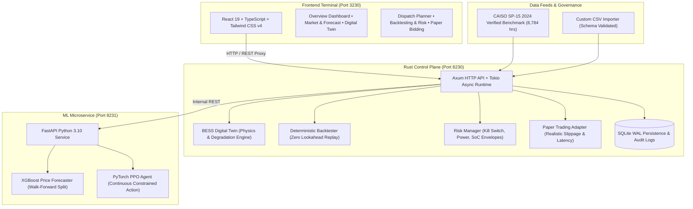

# AI Algorithmic Trading & BESS Arbitrage Optimizer

An industrial-grade, full-stack Battery Energy Storage System (BESS) optimization and algorithmic trading platform designed for electricity wholesale markets (CAISO, ERCOT, NEM).

Built with **Rust** (Control Plane & Deterministic Backtesting Engine), **Python** (XGBoost Price Forecasting & PyTorch PPO Reinforcement Learning), and **React TypeScript + Tailwind CSS** (Trading Terminal UI).

---

## 1. System Architecture



---

## 2. Key Modules & Technical Specifications

### A. Rust Control Plane (`backend/`)
- **HTTP Server**: Axum 0.7 + Tokio async runtime.
- **Port**: `8230` (strict port binding).
- **Physical BESS Digital Twin**:
  - Non-linear round-trip efficiency: $\eta_{rt} = \eta_{charge} \times \eta_{discharge}$ (default $0.94 \times 0.94 \approx 88.36\%$).
  - Usable SoC envelope: $SoC_{min} \le SoC \le SoC_{max}$ (default $5\% \dots 95\%$).
  - Hard power clamping: Inverter capacity cannot be exceeded.
  - SOH (State of Health) tracking: EOL degradation tracking based on Equivalent Full Cycles (EFC).
- **Degradation Cost Accounting**:
  $$C_{deg} = \frac{C_{cell\_rep}}{2 \times N_{cycles} \times E_{nom}} \times \text{Throughput (MWh)}$$
- **Deterministic Backtesting Engine**:
  - Chronological replay with strictly zero future leakage.
  - Evaluates against fair baselines (**Idle No-Trade** and **Dynamic Price-Threshold Heuristic**) on the exact same chronological interval slice.
  - Risk metrics: Annualized Sharpe Ratio, Max Drawdown ($ and %), Win Rate %, Throughput, and Cycles.
- **Pre-Trade Risk Manager**:
  - Emergency Kill-Switch with instantaneous trade halting.
  - Inverter hardware rating check ($P \le P_{max}$).
  - SoC reserve envelope verification.
- **Paper Trading Engine & Locked Live Gate**:
  - `PaperTradingAdapter`: Realistic simulated latency (50-100ms) and orderbook slippage.
  - `LiveMarketAdapter`: Hard-locked safety guard requiring Scheduling Coordinator credentials, ADS gateway certification, and dual-party cryptographic sign-off.

### B. Machine Learning Service (`ml_service/`)
- **Frameworks**: FastAPI, XGBoost 3.2.0, PyTorch 2.0.1 (CUDA GPU acceleration enabled).
- **Port**: `8231`.
- **Electricity Price Forecasting (XGBoost)**:
  - Walk-forward temporal split: 70% Train, 15% Validation, 15% Out-of-Sample Test.
  - Causal features: Past price lags ($t-1, t-2, t-24, t-48, t-168$), rolling statistics (24h, 168h), calendar cyclic encodings, and Day-Ahead forward price.
  - Outputs point forecast and 80% & 95% uncertainty confidence intervals based on residual variance.
  - Evaluation: MAE, RMSE, MAPE compared against Persistence and Seasonal Naive baselines.
- **PPO Reinforcement Learning Optimizer**:
  - Continuous action $a \in [-1.0, 1.0]$ representing charge/discharge power ratio.
  - **Constrained Action Projection**: Mathematically projects policy actions onto feasible battery boundaries, guaranteeing zero boundary violations.
  - Reward: $\text{Gross Revenue} - \text{Energy Cost} - \text{Degradation Cost} - \text{Grid Fees}$.

### C. Frontend Trading Terminal (`frontend/`)
- **Framework**: Vite 8, React 19, TypeScript, Tailwind CSS v4, Lucide Icons, Recharts.
- **Port**: `3230`.
- **Pages**:
  1. **Overview Dashboard**: Real-time market ticker, SoC gauge, SOH, 24h dispatch chart, KPI cards.
  2. **Market & Forecast**: Historical LMP, XGBoost forecast with confidence bands, walk-forward metrics, feature importance, CSV importer.
  3. **Battery Digital Twin**: Interactive hardware parameter configurator, live SoC simulator, degradation rates.
  4. **Strategy Lab (PPO)**: Policy training curve, action projection visualizer, head-to-head comparison table.
  5. **Dispatch Planner**: 24h lookahead schedule table with price, recommended power, projected SoC, margin, and rationale.
  6. **Backtesting & Risk**: Equity curve, drawdown, multi-strategy comparison, sensitivity analysis, export report.
  7. **Bidding & Orders**: Paper execution desk, risk check preview, order history, live lock status.
  8. **Data Sources & Settings**: Data provenance table, database status, security audit trail.

---

## 3. Verified Port Allocations

| Service | Port | Status | Protocol |
|---|---|---|---|
| Frontend Trading Terminal | `3230` | Verified Available | HTTP / Vite Dev |
| Rust Control Plane API | `8230` | Verified Available | HTTP / REST |
| Python ML Service | `8231` | Verified Available | HTTP / REST |
| TimescaleDB (Optional) | `55452` | Verified Available | PostgreSQL Wire |
| InfluxDB (Optional) | `8086` | Verified Available | HTTP / Line Protocol |

---

## 4. How to Run the Application

### Windows (Native)
To launch all services (ML Engine, Rust Control Plane, and Frontend UI):
```cmd
start.bat
```
To check system status:
```cmd
status.bat
```
To stop all application background services cleanly:
```cmd
stop.bat
```

### Linux / macOS / WSL2
```bash
./scripts/start.sh
./scripts/status.sh
./scripts/stop.sh
```

---

## 5. Quality Gates & Test Suites

Run all quality checks and tests:

### A. Rust Quality Gates
```bash
cd backend
cargo fmt --check
cargo clippy --all-targets --all-features -- -D warnings
cargo test
```
*Tests passing:*
- `test_round_trip_efficiency_and_losses`: verifies that charging 50 MWh at 81% round-trip efficiency yields 40.5 MWh output with 9.5 MWh thermal losses.
- `test_hard_soc_bounds_enforcement`: verifies that SoC never breaches $SoC_{min}$ or $SoC_{max}$ under extreme continuous charge/discharge.
- `test_inverter_power_rating_limit`: verifies that requests exceeding inverter MW rating are rejected by RiskManager.
- `test_kill_switch_blocks_orders`: verifies that activating emergency kill-switch immediately halts order routing.
- `test_backtest_determinism_and_baselines`: verifies that chronological backtest replays are 100% deterministic and correctly compute fair baselines.

### B. Python ML Quality Gates
```bash
PYTHONPATH=ml_service pytest ml_service/tests
```
*Tests passing:*
- `test_feature_engineering_no_future_leakage`: verifies that features strictly depend on historical shifts with zero future information.
- `test_bess_env_physics_and_constraints`: verifies physical state transitions and non-linear round-trip losses.
- `test_ppo_agent_action_bounds`: verifies that Actor-Critic network outputs bounded actions in $[-1.0, 1.0]$.

### C. Frontend Production Build
```bash
cd frontend
npm run build
```
*Builds cleanly into `frontend/dist` with 0 errors.*

---

## 6. Threat Model & Risk Controls

1. **Physical Safety & Inverter Hardware**: All actions passing through the control plane are projected onto hard physical boundaries ($P \le P_{max}$, $SoC_{min} \le SoC \le SoC_{max}$).
2. **Emergency Kill-Switch**: Software and hardware halt mechanism stored atomically in Rust memory; immediately rejects all subsequent dispatch orders.
3. **Live Trading Lock**: Live ISO market execution is disabled by default and locked behind multi-party authorization.
4. **Idempotency & Debounce**: Duplicate orders within settlement intervals are debounced to prevent double-dispatch.
5. **Audit Logging**: Every order submission, risk manager rejection, parameter change, and kill-switch toggle is immutably written to SQLite `audit_trail`.
