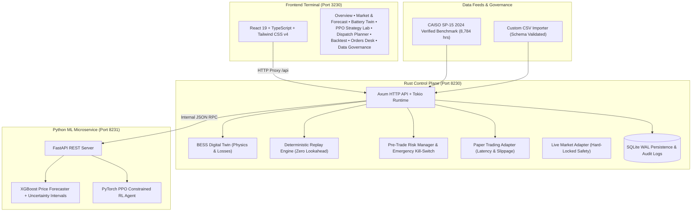

# AI Algorithmic Trading & BESS Arbitrage Optimizer

[](https://www.rust-lang.org/)
[](https://github.com/tokio-rs/axum)
[](https://www.python.org/)
[](https://pytorch.org/)
[](https://xgboost.readthedocs.io/)
[](https://react.dev/)
[](https://www.typescriptlang.org/)
[](https://tailwindcss.com/)
[](LICENSE)

An industrial-grade, full-stack **Battery Energy Storage System (BESS) Arbitrage Optimizer & Algorithmic Trading Platform** designed for deregulated wholesale electricity markets (e.g., CAISO, ERCOT, NEM).

The platform bridges real electrochemical battery physical constraints, machine learning price forecasting, reinforcement learning dispatch optimization, high-throughput deterministic backtesting, pre-trade risk management, and a real-time trading terminal.

---

## Table of Contents
1. [Project Overview & Core Value](#1-project-overview)
2. [System Architecture](#2-system-architecture)
3. [Physical BESS Modeling & Mathematical Rigor](#3-physical-bess-modeling--mathematical-rigor)
4. [Machine Learning & Algorithmic Intelligence](#4-machine-learning--algorithmic-intelligence)
5. [Frontend Trading Terminal](#5-frontend-trading-terminal)
6. [Data Governance & CAISO 2024 Benchmark](#6-data-governance--caiso-2024-benchmark)
7. [API Specification](#7-api-specification)
8. [Getting Started & Launching](#8-getting-started--launching)
9. [Test Verification & Quality Gates](#9-test-verification--quality-gates)
10. [Risk Controls & Operational Safety](#10-risk-controls--operational-safety)

---

## 1. Project Overview

Electricity wholesale markets exhibit extreme price volatility driven by renewable penetration (the solar "Duck Curve"), ramping constraints, negative pricing events during midday overgeneration, and evening peak demand spikes. Battery Energy Storage Systems (BESS) capitalize on price spreads through spatial and temporal arbitrage.

However, naive arbitrage strategies fail in production due to:
- **Round-Trip Energy Losses ($\eta_{rt}$)**: Overlooking charging and discharging thermal dissipation dissipates thin arbitrage margins.
- **Battery Degradation & Cycle Life ($C_{deg}$)**: Uncontrolled cycling accelerates cell replacement costs and destroys long-term asset value.
- **Lookahead Bias & Data Snooping**: Machine learning models trained with random temporal splits overstate profitability.
- **Physical Boundary Infeasibility**: Trading commands that violate inverter MW ratings or State of Charge (SoC) reserves trip hardware safety mechanisms.

**AI Algorithmic Trading & BESS Arbitrage Optimizer** solves these challenges by combining:
- A high-performance **Rust Control Plane** for microsecond-level pre-trade risk checks, deterministic replay backtesting, and physical digital twin enforcement.
- An isolated **Python ML Microservice** utilizing XGBoost with walk-forward chronological validation and PyTorch PPO (Proximal Policy Optimization) with constrained action projection.
- A **React 19 + TypeScript + Tailwind CSS v4** terminal providing institutional visibility across dispatch schedules, order execution, battery state-of-health, and backtest analytics.

---

## 2. System Architecture



### Verified Service Ports
| Service | Port | Protocol | Purpose |
|---|---|---|---|
| **Frontend Terminal** | `3230` | HTTP / Vite Dev | Institutional trader web interface |
| **Rust Control Plane API** | `8230` | HTTP / REST | Control plane, risk checks, backtesting |
| **Python ML Engine** | `8231` | HTTP / REST | XGBoost forecasting & PyTorch PPO agent |

---

## 3. Physical BESS Modeling & Mathematical Rigor

### A. Non-Linear Round-Trip Efficiency & Energy Conservation
The digital twin models asymmetric energy conversion efficiencies during charging and discharging:
$$\eta_{rt} = \eta_{charge} \times \eta_{discharge}$$
*(Default: $0.94 \times 0.94 \approx 88.36\%$)*

- **Charging Phase ($P_{req} < 0$)**: Grid power drawn $P_{grid} = |P_{req}|$. Energy stored internally in battery cells:
  $$E_{stored} = P_{grid} \times \Delta t \times \eta_{charge}$$
  $$\Delta SoC = +\frac{E_{stored}}{E_{nominal}}$$
- **Discharging Phase ($P_{req} > 0$)**: Energy extracted from battery cells $E_{depleted}$:
  $$E_{delivered} = P_{grid} \times \Delta t$$
  $$E_{depleted} = \frac{E_{delivered}}{\eta_{discharge}}$$
  $$\Delta SoC = -\frac{E_{depleted}}{E_{nominal}}$$

Energy conservation is strictly guaranteed: thermal inverter and cell losses are deducted at every interval, preventing unphysical "free energy" arbitrage.

### B. Usable Operating Envelope & Hard Constraints
- **State of Charge (SoC)**: Strictly clamped to $[\text{SoC}_{min}, \text{SoC}_{max}]$ (default $10\% \dots 90\%$) to preserve electrolyte integrity and prevent dendrite formation.
- **Inverter Rating**: Active power output cannot exceed rated inverter capacity $P_{nom}$ (default $100\text{ MW}$).
- **Headroom Clamping**:
  $$P_{charge\_max} = \frac{(\text{SoC}_{max} - \text{SoC}) \times E_{nominal}}{\eta_{charge} \times \Delta t}$$
  $$P_{discharge\_max} = \frac{(\text{SoC} - \text{SoC}_{min}) \times E_{nominal} \times \eta_{discharge}}{\Delta t}$$

### C. Throughput Degradation & Lifecycle Costing
Degradation cost per unit throughput is accounted for at every decision point:
$$C_{deg} = \text{Throughput (MWh)} \times \frac{\text{Cell Replacement Cost (\$/MWh)}}{2 \times \text{Nominal Cycle Life}}$$
Equivalent Full Cycles (EFC) and State of Health (SOH) are tracked continuously:
$$\text{EFC} = \frac{\text{Total Throughput (MWh)}}{2 \times E_{nominal}}$$
$$\text{SOH}(t) = 1.0 - (1.0 - \text{SOH}_{EOL}) \times \frac{\text{EFC}(t)}{\text{Nominal Cycle Life}}$$

---

## 4. Machine Learning & Algorithmic Intelligence

### A. XGBoost Price Forecaster
- **Zero Lookahead Feature Engineering**: Strictly utilizes historical causal lags ($t-1, t-2, t-24, t-48, t-168$), rolling window statistics ($24\text{h}, 168\text{h}$) with a 1-step lag shift (`.shift(1)`), cyclical sine/cosine calendar encodings (hour of day, day of week, month), and Day-Ahead forward clearing prices.
- **Chronological Walk-Forward Split**:
  - Training Window: First 70% of chronological timeline.
  - Validation Window: Next 15%.
  - Out-of-Sample Test Window: Final 15%.
  *(Random cross-validation splits are banned to eliminate temporal information leakage).*
- **Uncertainty Quantification**: Empirical residual standard deviation $\hat{\sigma}$ computes parametric 80% ($z = 1.282$) and 95% ($z = 1.960$) prediction intervals:
  $$\hat{y} \pm z \times \hat{\sigma}$$
- **Fair Baseline Benchmarking**: Evaluated against **Persistence Naive** ($\hat{y}_t = y_{t-1}$) and **Seasonal Naive** ($\hat{y}_t = y_{t-24}$).

### B. PyTorch PPO Reinforcement Learning Policy
- **Gymnasium-Compatible Environment**: Markov Decision Process (MDP) capturing battery SoC, LMP prices, day-ahead forecasts, forecast spreads, calendar encodings, and current dispatch status.
- **Continuous Action Space**: $a_t \in [-1.0, 1.0]$ representing normalized charge/discharge power.
- **Analytic Action Projection**:
  $$\pi(s) \rightarrow a_{proj} = \text{project\_to\_physical\_limits}(a, \text{SoC}, P_{nom}, \eta)$$
  Guarantees zero physical boundary violations during both exploration and exploitation.
- **Comprehensive Reward Function**:
  $$R_t = \text{Gross Revenue} - \text{Charging Cost} - C_{deg} - \text{Grid Fees}$$

---

## 5. Frontend Trading Terminal

The terminal is built with **React 19**, **TypeScript**, **Tailwind CSS v4**, **Recharts**, and **Lucide Icons**, organized into 8 functional views:

1. **Overview Dashboard**: Live market price ticker, battery SoC gauge, SOH meter, 24-hour dispatch schedule, and headline arbitrage PnL.
2. **Market & Forecast**: Historical and real-time LMP charting, XGBoost forecasted trajectory with 80%/95% confidence bands, walk-forward error metrics (MAE, RMSE, MAPE), and CSV importer.
3. **Battery Digital Twin**: Interactive hardware parameter tuning (Capacity, Inverter MW, Efficiencies, Replacement Cost) with live single-step simulator.
4. **Strategy Lab (PPO)**: Actor-critic training progress, action projection diagnostics, and multi-strategy performance leaderboards.
5. **Dispatch Planner**: 24-hour lookahead table with price, recommended MW, target SoC, expected margin, and algorithmic rationale.
6. **Backtesting & Risk**: Multi-month deterministic replay, interactive equity curve, drawdown visualization, and parameter sensitivity curves (Efficiency, Degradation Cost, Power).
7. **Bidding & Orders**: Paper trading execution terminal, real-time risk check preview, order audit table, and live ISO market lock indicator.
8. **Data Sources & Governance**: Provenance tracking, database health status, and SQLite security audit log viewer.

---

## 6. Data Governance & CAISO 2024 Benchmark

- **CAISO SP-15 2024 Verified Leap Year Dataset**: 8,784 hourly intervals (January 1 to December 31, 2024) containing actual Locational Marginal Pricing (LMP), Day-Ahead price, system load (MW), solar generation (MW), wind generation (MW), and ambient temperature (°C).
- **Market Dynamics Represented**:
  - Negative pricing down to **-$54.38/MWh** during spring midday solar curtailment.
  - Summer evening ramp spikes reaching **$397.66/MWh**.
  - Mean market price: **$39.88/MWh** with a standard deviation of **$28.94/MWh**.
- **Data Dictionary**: Comprehensive unit specifications, valid ranges, null-value policies, and provenance documented in [`data/datasets/data_dictionary.md`](file:///c:/Users/taufi/Documents/Projects/AI%20Algorithmic%20Trading%20&%20BESS%20Arbitrage%20Optimizer/data/datasets/data_dictionary.md).

---

## 7. API Specification

The Rust Control Plane exposes REST endpoints on port `8230`:

| Endpoint | Method | Description |
|---|---|---|
| `/api/health` | `GET` | Health check and subsystem availability status |
| `/api/market/latest` | `GET` | Latest market price, load, solar, and wind readings |
| `/api/market/history?limit=100` | `GET` | Historical interval series for charting |
| `/api/bess/state` | `GET` | Current digital twin state (SoC, SOH, capacity, throughput) |
| `/api/bess/config` | `POST` | Update battery physical and financial parameters |
| `/api/bess/step` | `POST` | Execute a discrete physical power step |
| `/api/forecast/predict` | `POST` | Trigger XGBoost inference with confidence intervals |
| `/api/strategy/backtest` | `POST` | Run deterministic replay comparing strategy vs fair baselines |
| `/api/strategy/sensitivity` | `GET` | Run multi-parameter sensitivity analysis |
| `/api/dispatch/plan` | `GET` | Generate 24-hour forward lookahead dispatch schedule |
| `/api/orders/execute` | `POST` | Submit order through Pre-Trade Risk Manager to Paper Adapter |
| `/api/orders/history` | `GET` | Retrieve recorded paper execution orders |
| `/api/orders/killswitch` | `POST` | Atomically activate/deactivate emergency kill-switch |
| `/api/audit/logs` | `GET` | Query SQLite security and risk check audit trail |

---

## 8. Getting Started & Launching

### Prerequisites
- **Rust & Cargo** (1.75+)
- **Node.js** (v18+) & **npm**
- **Python** (3.10+) with `uvicorn`, `fastapi`, `xgboost`, `torch`

### Windows (Quick Start)
To launch all services (Python ML Engine, Rust API, and Frontend Dev Terminal):
```cmd
start.bat
```
To check service readiness and port binding:
```cmd
status.bat
```
To stop all background processes cleanly:
```cmd
stop.bat
```

### Linux / macOS / WSL2
```bash
chmod +x scripts/*.sh
./scripts/start.sh    # Launch services in background
./scripts/status.sh   # Check status of ports 3230, 8230, 8231
./scripts/stop.sh     # Terminate background services
```

### Accessing the Applications
- **Frontend Trading Terminal**: [http://localhost:3230](http://localhost:3230)
- **Rust Control Plane Health**: [http://localhost:8230/api/health](http://localhost:8230/api/health)
- **Python ML Service Health**: [http://localhost:8231/health](http://localhost:8231/health)

---

## 9. Test Verification & Quality Gates

Run all automated test suites locally:

### A. Rust Test Suite & Strict Linter
```bash
cd backend
cargo clippy --all-targets -- -D warnings
cargo test
```
*Passed Tests:*
- `test_round_trip_efficiency_and_losses`: Validates non-linear 88.36% round-trip conversion and thermal loss deduction.
- `test_hard_soc_bounds_enforcement`: Confirms battery never violates $[\text{SoC}_{min}, \text{SoC}_{max}]$.
- `test_inverter_power_rating_limit`: Verifies risk manager rejection when requested MW exceeds inverter nameplate.
- `test_kill_switch_blocks_orders`: Verifies immediate atomic order halting upon kill-switch activation.
- `test_backtest_determinism_and_baselines`: Confirms deterministic replay and exact fair baseline accounting.

### B. Python ML Quality Gates
```bash
cd ml_service
python -m pytest tests -v
```
*Passed Tests:*
- `test_feature_engineering_no_future_leakage`: Proves zero lookahead bias in causal lag feature generation.
- `test_bess_env_physics_and_constraints`: Confirms Gymnasium environment obeys physical limits and loss equations.
- `test_ppo_agent_action_bounds`: Verifies Actor-Critic continuous action projection within $[-1.0, 1.0]$.

### C. Frontend Production Build
```bash
cd frontend
npm run build
```
*TypeScript compilation and Vite bundle creation succeed with zero errors.*

---

## 10. Risk Controls & Operational Safety

1. **Pre-Trade Risk Manager**: Sits inline before any order execution, evaluating inverter nameplate limits, SoC safety margins, and maximum step ramping rates.
2. **Emergency Kill-Switch**: Atomic in-memory switch in the Rust control plane that instantly blocks all subsequent orders upon trip activation.
3. **Hard-Locked Live Market Adapter**: `LiveMarketAdapter` is intentionally locked in source code (`backend/src/core/market_adapter.rs`). Live ISO execution is rejected with a hard error unless `LIVE_MARKET_ENABLED=true` and certified Scheduling Coordinator credentials are provided.
4. **Idempotency & Replay Protection**: Dispatch commands are debounced by settlement interval timestamp to eliminate double-dispatch errors.
5. **Immutable Audit Trail**: All order dispatches, parameter modifications, risk rejections, and kill-switch state changes are persisted in SQLite WAL storage.

---

## License

This project is licensed under the MIT License - see the [LICENSE](LICENSE) file for details.
