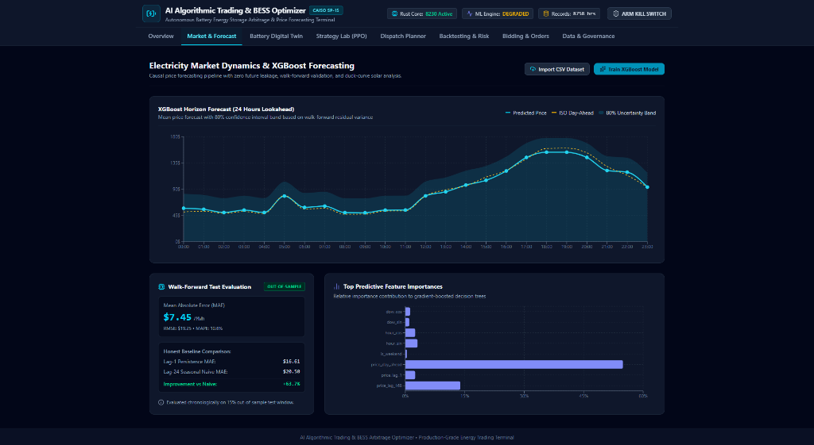
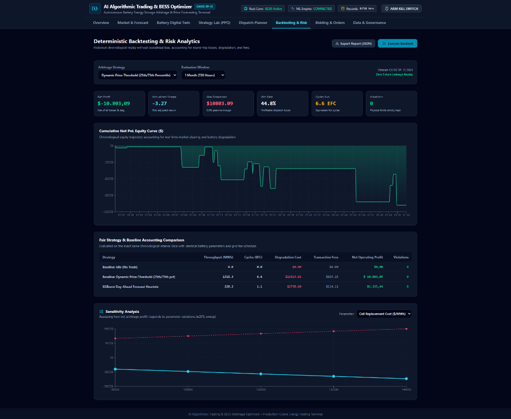
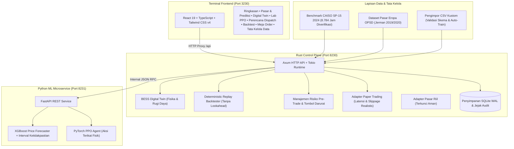

# AI Algorithmic Trading & BESS Arbitrage Optimizer

[](https://www.rust-lang.org/)
[](https://github.com/tokio-rs/axum)
[](https://www.python.org/)
[](https://pytorch.org/)
[](https://xgboost.readthedocs.io/)
[](https://react.dev/)
[](https://www.typescriptlang.org/)
[](https://tailwindcss.com/)
[](LICENSE)

Platform terintegrasi skala industri untuk **Optimasi Arbitrase & Algorithmic Trading Battery Energy Storage System (BESS)** pada pasar listrik grosir (*wholesale electricity markets* seperti CAISO, ERCOT, dan pasar Eropa ENTSO-E).

Sistem ini menjembatani batas fisik elektrokimia baterai nyata, peramalan harga listrik (*price forecasting*) dengan Machine Learning, optimasi *dispatch* berbasis Reinforcement Learning, mesin *backtesting* deterministik berkecepatan tinggi, manajemen risiko *pre-trade*, dan terminal perdagangan interaktif berbasis web.

---

## Daftar Isi
1. [Gambaran Umum & Nilai Utama](#1-gambaran-umum--nilai-utama)
2. [Pratinjau Antarmuka Terminal Trading](#2-pratinjau-antarmuka-terminal-trading)
3. [Arsitektur Sistem](#3-arsitektur-sistem)
4. [Pemodelan Fisika BESS & Ketelitian Matematis](#4-pemodelan-fisika-bess--ketelitian-matematis)
5. [Kecerdasan Buatan & Machine Learning](#5-kecerdasan-buatan--machine-learning)
6. [Terminal Trading Frontend](#6-terminal-trading-frontend)
7. [Tata Kelola Data, Multi-Pasar & Alat Konversi Benchmark](#7-tata-kelola-data-multi-pasar--alat-konversi-benchmark)
8. [Spesifikasi API](#8-spesifikasi-api)
9. [Panduan Instalasi & Menjalankan Aplikasi](#9-panduan-instalasi--menjalankan-aplikasi)
10. [Verifikasi Pengujian & Quality Gates](#10-verifikasi-pengujian--quality-gates)
11. [Manajemen Risiko & Keamanan Operasional](#11-manajemen-risiko--keamanan-operasional)
12. [Lisensi](#lisensi)

---

## 1. Gambaran Umum & Nilai Utama

Pasar listrik grosir modern ditandai oleh volatilitas harga yang sangat ekstrem akibat penetrasi energi terbarukan (fenomena *Duck Curve* dari pembangkit surya), batasan *ramping* generator termal, kejadian harga negatif saat kelebihan pasokan di siang hari, dan lonjakan harga (*price spike*) saat beban puncak petang. Sistem Penyimpanan Energi Baterai (BESS) menangkap peluang penyebaran harga ini melalui arbitrase temporal.

Namun, strategi arbitrase naif sering kali gagal di dunia nyata karena:
- **Rugi Daya Bolak-Balik (Round-Trip Losses)**: Mengabaikan efisiensi konversi termal saat pengisian dan pelepasan mengikis margin arbitrase tipis.
- **Biaya Degradasi Baterai & Hurdle Rate**: Siklus pengisian yang tidak terkendali mempercepat degradasi sel sehingga biaya keausan fisik baterai melampaui keuntungan selisih energi (*asset cannibalization*).
- **Lookahead Bias & Data Snooping**: Model Machine Learning yang dilatih tanpa pemisahan temporal yang ketat menghasilkan profitabilitas palsu.
- **Pelanggaran Batas Fisik Inverter & SoC**: Perintah dispatch yang melanggar batas MW inverter atau cadangan State of Charge (SoC) akan memicu trip proteksi perangkat keras.

**AI Algorithmic Trading & BESS Arbitrage Optimizer** mengatasi tantangan tersebut secara menyeluruh melalui:
- **Rust Control Plane**: Engine performa tinggi untuk validasi risiko *pre-trade* tingkat mikrodetik, *backtester* pemutaran ulang deterministik, dan penegakan *digital twin* fisika baterai.
- **Python ML Microservice**: Layanan terisolasi dengan XGBoost (*walk-forward chronological validation*) dan PyTorch PPO (*Proximal Policy Optimization*) dengan proyeksi aksi terikat analitik (*constrained action mapping*).
- **React 19 + TypeScript + Tailwind CSS v4 Terminal**: Antarmuka institusional untuk memantau jadwal *dispatch*, eksekusi *paper trading*, status kesehatan baterai (SOH), dan analisis performa strategi.

---

## 2. Pratinjau Antarmuka Terminal Trading

Berikut adalah dokumentasi visual dari fitur-fitur operasional terminal trading:

### A. Dinamika Pasar Listrik & Peramalan XGBoost (Market & Forecast)


Panel ini menyediakan analitik peramalan harga pasar listrik grosir (Locational Marginal Price / LMP) secara kausal tanpa kebocoran data masa depan (*zero lookahead bias*):
- **Horizon Forecast 24 Jam**: Membandingkan kurva harga prediksi model AI (biru terang) dengan harga acuan Day-Ahead ISO (kuning), dilengkapi pita ketidakpastian parametrik 80% (*80% Uncertainty Band*).
- **Evaluasi Out-of-Sample Walk-Forward**: Pengujian kronologis pada 15% data terpisah menghasilkan metrik evaluasi nyata (**MAE $7.45/MWh**, RMSE $19.25, MAPE 10.8%).
- **Tolok Ukur Baseline Jujur**: Menunjukkan peningkatan akurasi **+63.7%** dibandingkan model acuan naif (*Lag-1 Persistence MAE: $16.61*, *Lag-24 Seasonal Naive MAE: $20.58*).
- **Bobot Fitur Prediktif Utama (*Feature Importances*)**: Menyorot pengaruh terbesar pohon keputusan gradien (`price_day_ahead`, `price_lag_168`, komponen siklikal waktu `hour_sin`, dll.).
- **Dukungan Multi-Dataset**: Dilengkapi fitur *Import CSV Dataset* dengan validasi skema otomatis dan pelatihan ulang model XGBoost secara instan (*Train XGBoost Model*).

---

### B. Backtesting Deterministik & Analisis Risiko (Backtesting & Risk)


Panel simulasi performa historis dengan memperhitungkan hukum fisika elektrokimia baterai secara realistis:
- **Kurva Ekuitas Kumulatif (Cumulative Net PnL Curve)**: Visualisasi pergerakan modal bersih terhadap waktu yang telah dipotong rugi efisiensi baterai, biaya keausan siklus sel, dan biaya jaringan.
- **Akuntansi Strategi & Baseline yang Adil**:
  - *Baseline Idle (No Trade)*: $0.00 (tanpa aktivitas).
  - *Baseline Dynamic Price-Threshold (25th/75th Percentile)*: Menguji heuristik arbitrase dinamis berbasis persentil berjalan.
  - *XGBoost Day-Ahead Forecast Heuristic*: Mengoptimalkan waktu dispatch berdasarkan sinyal peramalan AI, menghasilkan laba operasi bersih positif (**+$1.325,44**).
- **Metrik Kinerja Komprehensif**: Menampilkan Net Profit, Annualized Sharpe Ratio, Max Drawdown, Win Rate, Equivalent Full Cycles (EFC), dan pelacakan pelanggaran batas keras (*Zero Constraint Violations*).
- **Analisis Sensitivitas Parameter Interaktif**: Menilai ketahanan margin profit terhadap variasi parameter fisik (misalnya biaya penggantian sel $\pm 20\%$, efisiensi bolak-balik, atau kapasitas inverter).

---

## 3. Arsitektur Sistem



### Alokasi Port Layanan
| Layanan | Port | Protokol | Deskripsi |
|---|---|---|---|
| **Terminal Frontend** | `3230` | HTTP / Vite Dev | Antarmuka pengguna terminal trading institusional |
| **Rust Control Plane API** | `8230` | HTTP / REST | Control plane, pemeriksaan risiko, simulasi backtest |
| **Python ML Engine** | `8231` | HTTP / REST | Peramalan harga XGBoost & agen Reinforcement Learning PPO |

---

## 4. Pemodelan Fisika BESS & Ketelitian Matematis

### A. Efisiensi Round-Trip Non-Linear & Konservasi Energi
Digital twin memodelkan efisiensi konversi asimetris saat pengisian (*charging*) dan pelepasan (*discharging*):

$$
\eta_{\text{rt}} = \eta_{\text{charge}} \times \eta_{\text{discharge}}
$$

*(Nilai standar: 0.94 × 0.94 ≈ 88.36%)*

#### 1. Fase Pengisian Daya (Charging, P < 0)
Daya diserap dari jaringan grid sebesar $P_{\text{grid}} = |P_{\text{req}}|$. Energi internal yang tersimpan ke dalam sel baterai:

$$
E_{\text{stored}} = P_{\text{grid}} \cdot \Delta t \cdot \eta_{\text{charge}}
$$

$$
\Delta \text{SoC} = +\frac{E_{\text{stored}}}{E_{\text{nominal}}}
$$

#### 2. Fase Pelepasan Daya (Discharging, P > 0)
Daya dikirim ke jaringan grid sebesar $P_{\text{grid}} = P_{\text{req}}$. Energi internal baterai yang terkuras:

$$
E_{\text{delivered}} = P_{\text{grid}} \cdot \Delta t
$$

$$
E_{\text{depleted}} = \frac{E_{\text{delivered}}}{\eta_{\text{discharge}}}
$$

$$
\Delta \text{SoC} = -\frac{E_{\text{depleted}}}{E_{\text{nominal}}}
$$

Konservasi energi ditegakkan secara mutlak: kerugian termal inverter dan sel dipotong pada setiap interval waktu, sehingga tidak ada energi gratis yang dihasilkan.

---

### B. Amplop Operasi & Batas Fisik Keras (Hard Constraints)
- **Rentang State of Charge (SoC)**: Terikat ketat pada batas aman 5% hingga 95% (`SoC_min` s.d. `SoC_max`) untuk mencegah degradasi kimiawi elektroda dan pembentukan dendrit litium.
- **Peringkat Daya Inverter**: Daya aktif tidak boleh melampaui kapasitas nominal inverter `P_nom` (default 50 MW).
- **Batas Headroom Fisik Pengisian dan Pelepasan Daya**:

$$
P_{\text{charge,max}} = \frac{(\text{SoC}_{\max} - \text{SoC}) \cdot E_{\text{nominal}}}{\eta_{\text{charge}} \cdot \Delta t}
$$

$$
P_{\text{discharge,max}} = \frac{(\text{SoC} - \text{SoC}_{\min}) \cdot E_{\text{nominal}} \cdot \eta_{\text{discharge}}}{\Delta t}
$$

---

### C. Pemodelan Degradasi Throughput & Biaya Siklus
Biaya degradasi sel baterai dihitung pada setiap langkah keputusan berdasarkan pemakaian throughput energi:

$$
C_{\text{deg}} = \text{Throughput} \times \frac{\text{Biaya Penggantian Sel per MWh}}{2 \times \text{Cycle Life Nominal}}
$$

Equivalent Full Cycles (EFC) dan State of Health (SOH) dilacak secara kontinu:

$$
\text{EFC} = \frac{\text{Throughput Kumulatif}}{2 \cdot E_{\text{nominal}}}
$$

$$
\text{SOH}(t) = 1.0 - (1.0 - \text{SOH}_{\text{EOL}}) \times \frac{\text{EFC}(t)}{\text{Cycle Life Nominal}}
$$

---

### D. Degradation Hurdle Rate & Ekonomi Arbitrase Nyata
Sistem ini tidak menggunakan penyederhanaan yang keliru (seperti hanya menghitung margin selisih harga kotor $P_{\text{sell}} - P_{\text{buy}}$). Dalam operasi nyata, BESS memiliki ambang batas keekonomian yang ketat:

$$
\text{Hurdle Rate} \approx 2 \times C_{\text{deg}} + \Delta \text{Loss}_{\text{round-trip}} + 2 \times \text{Fee}_{\text{grid}}
$$

Untuk baterai utilitas standar 100 MWh / 50 MW (biaya sel $\$120.000/\text{MWh}$, umur nominal 5.000 siklus):
1. **Biaya Keausan Siklus**: $\frac{\$120.000}{2 \times 5.000} = \$12,00/\text{MWh}$ per arah throughput. Satu siklus penuh membutuhkan $\$24,00/\text{MWh}$.
2. **Rugi Konversi Bolak-Balik**: Efisiensi $0,94 \times 0,94 \approx 88,36\%$ menimbulkan kehilangan daya $\approx 11,64\%$.
3. **Ambang Batas Impas (*Break-Even Spread*)**: Baterai membutuhkan selisih harga pasar minimal **$\approx \$28 - \$30 / \text{MWh}$** agar setiap siklus menghasilkan laba bersih positif.

> [!IMPORTANT]
> - **Pada Pasar CAISO SP-15 2024**: Fluktuasi harian akibat *duck curve* sangat tinggi (spread > $100/MWh), sehingga strategi arbitrase menghasilkan laba bersih signifikan.
> - **Pada Pasar dengan Selisih Tipis (seperti Jerman 2020)**: Rata-rata spread harga harian hanya €13–€15/MWh (di bawah batas *hurdle rate* €28/MWh). Akibatnya, strategi heuristik sederhana yang memutar siklus tanpa filter spread akan mencatat nilai minus karena biaya degradasi sel baterai lebih besar daripada keuntungan selisih energi. Di sinilah peran krusial algoritma cerdas berbasis AI/PPO untuk menahan baterai dalam kondisi **IDLE** guna menjaga kesehatan sel saat spread pasar tidak menguntungkan.

---

## 5. Kecerdasan Buatan & Machine Learning

### A. Peramal Harga XGBoost (XGBoost Price Forecaster)
- **Feature Engineering Kausal Tanpa Kebocoran Informasi (Zero Lookahead)**: Hanya menggunakan lag harga historis ($t-1, t-2, t-24, t-48, t-168$), statistik bergulir (24 jam, 168 jam) dengan pergeseran waktu 1 langkah (`.shift(1)`), *cyclical sine/cosine calendar encoding* (jam, hari, bulan), dan harga pasar Day-Ahead yang telah dirilis hari sebelumnya.
- **Pemisahan Waktu Chronological Walk-Forward**:
  - Jendela Latih (*Train*): 70% awal dari garis waktu kronologis.
  - Jendela Validasi (*Validation*): 15% berikutnya.
  - Jendela Uji (*Out-of-Sample Test*): 15% akhir.
  *(Pemisahan acak/k-fold dilarang keras untuk mencegah kebocoran informasi masa depan).*
- **Kuantifikasi Ketidakpastian (Uncertainty Quantification)**: Deviasi standar residual empiris $\hat{\sigma}$ menghitung interval prediksi parametrik 80% ($z = 1.282$) dan 95% ($z = 1.960$):

$$
\hat{y} \pm z \cdot \hat{\sigma}
$$

- **Evaluasi Baseline yang Adil**: Dibandingkan langsung dengan model acuan:
  - Persistence Naive: $y(t-1)$
  - Seasonal Naive: $y(t-24)$

---

### B. Kebijakan Reinforcement Learning PPO (PyTorch)
- **Lingkungan Kompatibel Gymnasium**: Markov Decision Process (MDP) yang memodelkan SoC baterai, harga LMP pasar, perkiraan Day-Ahead, *forecast spread*, waktu kalender, dan status dispatch saat ini.
- **Ruang Aksi Kontinu**: $a \in [-1.0, 1.0]$ mewakili rasio daya pengisian atau pelepasan terhadap daya nominal.
- **Proyeksi Aksi Terikat Analitik (Analytic Action Projection)**:

$$
\pi(s) \rightarrow a_{\text{proj}} = \min\left(\max\left(a, a_{\min}\right), a_{\max}\right)
$$

Fungsi proyeksi analitik ini memetakan aksi agen secara matematis ke batas fisik baterai yang diizinkan sebelum diteruskan ke simulator. Hal ini menjamin 100% kepatuhan terhadap batas fisik tanpa melanggar batasan inverter maupun kapasitas.

- **Fungsi Reward Komprehensif**:

$$
R_t = \text{Pendapatan Kotor} - \text{Biaya Pengisian} - C_{\text{deg}} - \text{Biaya Jaringan/Transaksi}
$$

---

## 6. Terminal Trading Frontend

Antarmuka dibangun dengan **React 19**, **TypeScript**, **Tailwind CSS v4**, **Recharts**, dan **Lucide Icons**, mencakup 8 panel fungsional:

1. **Ringkasan (Overview Dashboard)**: Ticker harga pasar terkini, meteran gauge SoC baterai, meteran SOH, jadwal dispatch 24 jam, dan metrik PnL arbitrase.
2. **Pasar & Prediksi (Market & Forecast)**: Grafik riwayat LMP dan perkiraan XGBoost dengan pita keyakinan 80%/95%, metrik kesalahan evaluasi (MAE, RMSE, MAPE), dan pengimpor file CSV.
3. **Digital Twin Baterai (Battery Digital Twin)**: Pengatur parameter perangkat keras interaktif (Kapasitas MWh, Daya Inverter MW, Efisiensi, Biaya Penggantian) dilengkapi simulator eksekusi daya satu langkah.
4. **Lab Strategi PPO (Strategy Lab)**: Kurva pelatihan actor-critic, diagnostik proyeksi aksi, dan papan peringkat perbandingan performa antar strategi.
5. **Perencana Dispatch (Dispatch Planner)**: Tabel rencana 24 jam ke depan berisi harga, daya MW yang direkomendasikan, proyeksi SoC, estimasi margin, dan penjelasan rasional algoritma.
6. **Backtesting & Risiko (Backtesting & Risk)**: Pemutaran ulang deterministik multi-bulan, kurva ekuitas interaktif, visualisasi drawdown, dan kurva analisis sensitivitas parameter (Efisiensi, Biaya Degradasi, Daya MW).
7. **Bidding & Meja Order (Orders Desk)**: Terminal eksekusi paper trading, pratinjau pemeriksaan risiko pra-perdagangan, riwayat order, dan indikator penguncian pasar riil.
8. **Tata Kelola Data & Pengaturan (Data Governance)**: Pelacakan asal-usul dataset (*provenance*), status kesehatan database SQLite WAL, dan penampil log audit keamanan.

---

## 7. Tata Kelola Data, Multi-Pasar & Alat Konversi Benchmark

Platform ini dirancang fleksibel untuk mendukung berbagai pasar listrik internasional:

- **Dataset Benchmark CAISO SP-15 2024**: Berisi 8.784 interval jam penuh (1 Januari s.d. 31 Desember 2024 tahun kabisat) yang mencakup Locational Marginal Pricing (LMP) riil, harga Day-Ahead, beban sistem (MW), pembangkitan surya (MW), pembangkitan angin (MW), dan temperatur (°C).
  - Harga negatif hingga mencapai **-$54.38/MWh** saat pemangkasan pembangkit surya siang hari (*curtailment*).
  - Lonjakan harga petang hari (*evening ramp*) hingga mencapai **$397.66/MWh**.
  - Harga rata-rata pasar: **$39.88/MWh** dengan deviasi standar **$28.94/MWh**.
- **Dukungan Dataset Multi-Index Eropa (OPSD)**: Tersedia skrip konversi otomatis untuk mengekstrak dataset bersih dari Open Power System Data (Jerman, Prancis, Inggris, dll.):
  ```powershell
  python scripts/convert_opsd_to_benchmark.py --input "data/raw/time_series_60min_singleindex.csv" --country DE --year 2020
  ```
- **Pengimpor CSV Fleksibel di Terminal UI**:
  - Mendukung unggah langsung berkas CSV (*drag-and-drop*) maupun penempelan teks CSV mentah.
  - Pemetaan kolom pintar: otomatis mengenali variasi nama kolom harga internasional (`price_actual`, `price_day_ahead`, `cet_cest_timestamp`, `load_mw`, dll.).
  - **Sinkronisasi Pelatihan Otomatis**: Saat data baru diimpor, sistem secara otomatis melatih ulang model XGBoost dan menyinkronkan metrik evaluasi walk-forward secara instan.
- **Kamus Data (Data Dictionary)**: Spesifikasi satuan, batasan rentang valid, penanganan nilai hilang, dan rekam jejak sumber didokumentasikan di [`data/datasets/data_dictionary.md`](data/datasets/data_dictionary.md).

---

## 8. Spesifikasi API

Rust Control Plane menyediakan antarmuka REST API pada port `8230`:

| Endpoint | Metode | Deskripsi |
|---|---|---|
| `/api/health` | `GET` | Pemeriksaan kesehatan dan status ketersediaan subsistem |
| `/api/market/latest` | `GET` | Data harga pasar, beban, surya, dan angin terbaru |
| `/api/market/history?limit=100` | `GET` | Rangkaian data interval historis untuk visualisasi grafik |
| `/api/market/import` | `POST` | Mengimpor dataset pasar baru (CSV) dan menyinkronkan pipeline |
| `/api/bess/state` | `GET` | Status digital twin baterai saat ini (SoC, SOH, throughput, kapasitas) |
| `/api/bess/config` | `POST` | Memperbarui parameter fisik dan finansial BESS |
| `/api/bess/step` | `POST` | Menjalankan satu langkah simulasi daya diskrit |
| `/api/forecast/predict` | `POST` | Menjalankan inferensi XGBoost lengkap dengan pita keyakinan |
| `/api/forecast/train` | `POST` | Memicu pelatihan ulang model XGBoost pada dataset aktif |
| `/api/strategy/backtest` | `POST` | Menjalankan backtest deterministik membandingkan strategi vs baseline adil |
| `/api/strategy/sensitivity` | `GET` | Menjalankan analisis sensitivitas multi-parameter |
| `/api/dispatch/plan` | `GET` | Membuat jadwal rekomendasi dispatch 24 jam ke depan |
| `/api/orders/execute` | `POST` | Mengirimkan order melalui Risk Manager ke Paper Trading Adapter |
| `/api/orders/history` | `GET` | Mengambil riwayat eksekusi order paper trading |
| `/api/orders/killswitch` | `POST` | Mengaktifkan/menonaktifkan tombol darurat (Emergency Kill-Switch) |
| `/api/audit/logs` | `GET` | Mengambil jejak log audit keamanan dan pemeriksaan risiko dari SQLite |

---

## 9. Panduan Instalasi & Menjalankan Aplikasi

### Prasyarat Sistem
- **Rust & Cargo** (versi 1.75 atau lebih baru)
- **Node.js** (versi 18 atau lebih baru) & **npm**
- **Python** (versi 3.10 atau lebih baru) dengan pustaka `uvicorn`, `fastapi`, `xgboost`, `torch`

### Di Windows (Satu Kali Klik)
Untuk meluncurkan seluruh layanan secara otomatis (Python ML, Rust API, dan Frontend UI):
```cmd
start.bat
```
Untuk memeriksa status layanan dan keterikatan port:
```cmd
status.bat
```
Untuk menghentikan seluruh layanan latar belakang secara bersih:
```cmd
stop.bat
```

### Di Linux / macOS / WSL2
```bash
chmod +x scripts/*.sh
./scripts/start.sh    # Menjalankan layanan di latar belakang
./scripts/status.sh   # Memeriksa status port 3230, 8230, 8231
./scripts/stop.sh     # Menghentikan layanan secara bersih
```

### Mengakses Aplikasi
- **Terminal Trading Frontend**: [http://localhost:3230](http://localhost:3230)
- **Health Check Rust Control Plane**: [http://localhost:8230/api/health](http://localhost:8230/api/health)
- **Health Check Python ML Service**: [http://localhost:8231/health](http://localhost:8231/health)

---

## 10. Verifikasi Pengujian & Quality Gates

Seluruh suite pengujian otomatis dapat dijalankan secara lokal:

### A. Pengujian Backend Rust & Linter Ketat
```bash
cd backend
cargo clippy --all-targets -- -D warnings
cargo test
```
*Pengujian yang Berhasil:*
- `test_round_trip_efficiency_and_losses`: Memverifikasi konversi efisiensi bolak-balik non-linear 88.36% dan pemotongan rugi termal.
- `test_hard_soc_bounds_enforcement`: Memastikan SoC baterai tidak pernah melanggar batas aman 5% s.d. 95%.
- `test_inverter_power_rating_limit`: Memverifikasi penolakan oleh Risk Manager saat permintaan MW melebihi batas inverter.
- `test_kill_switch_blocks_orders`: Memverifikasi penghentian order secara atomik seketika saat tombol darurat aktif.
- `test_backtest_determinism_and_baselines`: Memastikan pemutaran ulang backtest 100% deterministik dan perhitungan baseline adil.

### B. Pengujian Python ML Service
```bash
cd ml_service
python -m pytest tests -v
```
*Pengujian yang Berhasil:*
- `test_feature_engineering_no_future_leakage`: Membuktikan nol kebocoran informasi masa depan (*zero lookahead*) pada lag fitur.
- `test_bess_env_physics_and_constraints`: Memastikan lingkungan Gymnasium mematuhi hukum fisika baterai dan efisiensi konversi.
- `test_ppo_agent_action_bounds`: Memverifikasi bahwa aksi kontinu jaringan Actor-Critic dibatasi secara ketat dalam rentang aman.

### C. Build Produksi Frontend
```bash
cd frontend
npm run build
```
*Kompilasi TypeScript dan pembuatan bundle Vite sukses dengan 0 kesalahan.*

---

## 11. Manajemen Risiko & Keamanan Operasional

1. **Pre-Trade Risk Manager**: Berada di jalur eksekusi sebelum order diteruskan, memvalidasi kapasitas batas daya inverter, margin keamanan SoC, dan laju kenaikan daya (*ramp rate*).
2. **Emergency Kill-Switch**: Tombol henti darurat atomik di memori Rust Control Plane yang langsung memblokir seluruh pengiriman order dispatch baru jika diaktifkan.
3. **Hard-Locked Live Market Adapter**: Adapter pasar riil (`LiveMarketAdapter`) secara sengaja dikunci dalam kode sumber ([`backend/src/core/market_adapter.rs`](backend/src/core/market_adapter.rs)). Eksekusi pasar riil akan ditolak dengan error eksplisit kecuali `LIVE_MARKET_ENABLED=true` dan kredensial resmi Scheduling Coordinator telah tervalidasi.
4. **Idempotensi & Pencegahan Duplikasi**: Perintah dispatch didebounce berdasarkan stempel waktu interval penyelesaian untuk mencegah eksekusi ganda (*double-dispatch*).
5. **Jejak Audit Kekal (Immutable Audit Trail)**: Setiap pengiriman order, perubahan parameter konfigurasi, penolakan risiko, dan pergantian status tombol darurat dicatat secara permanen di database SQLite WAL.

---

## Lisensi

Proyek ini dilisensikan di bawah Lisensi Apache 2.0 - lihat file [LICENSE](LICENSE) untuk informasi lebih lanjut.
